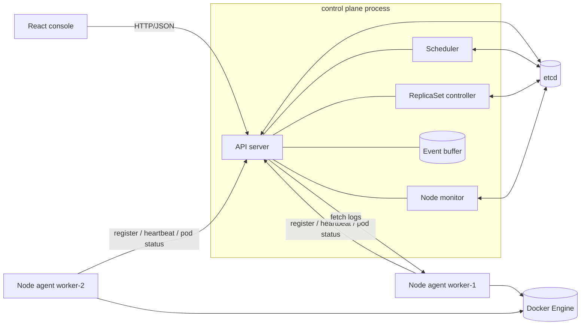

# Mini Orchestrator

**A pocket-sized, Kubernetes-inspired container orchestrator.** A Go control plane keeps cluster state in etcd, node agents run your containers with Docker, and a React console lets you watch the whole thing reconcile in real time.

> **Kubernetes-inspired, not Kubernetes-compatible.** This is a learning and portfolio project. It does not implement the Kubernetes API, CRI, CNI, CSI, RBAC or admission control, and the API has **no authentication**. Run it on your own machine, not on the internet.


---

## Contents

- [Why this exists](#why-this-exists)
- [What you can do with it](#what-you-can-do-with-it)
- [Feature matrix](#feature-matrix)
- [How it works](#how-it-works)
- [Tech stack](#tech-stack)
- [Repository layout](#repository-layout)
- [Quick start](#quick-start)
- [Configuration](#configuration)
- [API at a glance](#api-at-a-glance)
- [Testing](#testing)
- [Troubleshooting](#troubleshooting)
- [Limitations and security](#limitations-and-security)
- [Roadmap](#roadmap)
- [Docs](#docs)
- [Contributing](#contributing)
- [License](#license)

---

## Why this exists

Kubernetes is amazing, and also about two million lines of code. The core ideas are much smaller than that, so this project rebuilds them at a size you can actually read in an afternoon:

- **Desired vs observed state.** Every object has a `spec` (what you asked for) and a `status` (what's really happening).
- **Reconciliation loops.** Controllers keep comparing the two and nudge reality toward the spec, one small idempotent step at a time.
- **Optimistic concurrency.** Every etcd write is compare-and-swap, so two components can't silently overwrite each other or schedule the same pod twice.
- **Failure handling that you can see.** Nodes going quiet, containers crash-looping, bad images, etcd going down: each one has a clear, visible outcome instead of a mystery.

## What you can do with it

- Run single-container **pods** (`nginx:stable`, your own images, whatever).
- Create **ReplicaSets** and scale them up and down; failed pods get replaced automatically.
- Start several **node agents** and watch the scheduler spread pods across them.
- **Cordon** a node, kill an agent, and watch its pods go `Unknown` and then get rescheduled.
- Read **container logs** and a live **event feed** straight from the console.

## Feature matrix

| Area | Feature | Status |
|---|---|---|
| API | REST API for pods, ReplicaSets, nodes and events, strict JSON validation, one error format | Done |
| API | `/healthz` (is the process alive) and `/readyz` (can it reach etcd) | Done |
| API | Authentication / authorization | Planned |
| State | etcd storage with compare-and-swap transactions and a versioned key namespace | Done |
| Scheduling | `LeastPods` placement over declared pod slots, with human-readable pending reasons | Done |
| Scheduling | CPU / memory aware scheduling | Planned |
| Workloads | Pods with `Always` / `Never` restart policies, restart back-off | Done |
| Workloads | ReplicaSets: scale, replace failed pods, cascade delete | Done |
| Workloads | Deployments, rolling updates, services, volumes, published ports | Planned |
| Nodes | Agent registration, heartbeats, stale-node detection, cordon, safe removal | Done |
| Nodes | Pod eviction after node loss (`Unknown` → `Failed / NodeLost`) | Done |
| Runtime | Docker via the CLI behind a `Runtime` interface, orphan cleanup | Done |
| Observability | Structured logs (`log/slog`), request IDs, in-memory event history | Done |
| Observability | Container log snapshots proxied from the agent | Done |
| Observability | Prometheus metrics, persistent events, live log streaming | Planned |
| Console | Overview, Pods, ReplicaSets, Nodes, Events, Logs, About, with create / scale / delete flows | Done |
| DevOps | Docker Compose for etcd, Makefile, GitHub Actions CI | Done |

## How it works



There are two kinds of processes:

- **The control plane** (one process): the REST API, the scheduler, the ReplicaSet controller and the node monitor, all sharing an etcd-backed store.
- **Node agents** (one process per node): they register, send heartbeats, poll for the pods assigned to them, run those pods with Docker, report back, and serve logs. Agents only ever talk to the API, never to etcd.

When you run everything on one laptop, every agent uses the **same Docker daemon**. Multiple agents behave like multiple nodes, but they aren't isolated machines.

### The life of a pod

```text
POST /api/v1/pods ─► Pending ─(scheduler picks a node)─► Scheduled ─(agent starts container)─► Running
                                                                                       │
            restartPolicy Never:  exit 0 ─► Succeeded,  exit ≠ 0 ─► Failed  ◄──────────┤
            restartPolicy Always: restart with back-off; too many restarts ─► Failed
            node stops heartbeating ─► Unknown ─(still gone after 60s)─► Failed (NodeLost)
DELETE ─► Terminating ─(agent removes the container, then calls finalize)─► gone
```

Who's allowed to make each move, and why, is in [docs/ARCHITECTURE.md](docs/ARCHITECTURE.md).

## Tech stack

| Tech | Why it's here |
|---|---|
| **Go 1.25**, standard `net/http` routing, `log/slog` | Method-aware routing and structured logs with zero frameworks; goroutines + `context` make clean shutdown easy. |
| **etcd v3** | Same store Kubernetes uses. Transactions give compare-and-swap for free. |
| **Docker CLI** behind an interface | Already on every dev machine. Arguments go in as an argv slice, never through a shell. Tests use a fake. |
| **React 18, TypeScript, TanStack Query, Tailwind, shadcn/ui** | Typed API client, shared polling that pauses when the tab is hidden, accessible components. |
| **Docker Compose, Make, GitHub Actions** | One command for etcd, one place for dev commands, CI on every push. |

## Repository layout

```text
backend/
  cmd/controlplane/      API server + scheduler + controllers
  cmd/agent/             node agent
  internal/domain/       Pod, Node, ReplicaSet types, request types, validation
  internal/store/        KV interface, etcd implementation, in-memory test double
  internal/lifecycle/    shared state-change rules (delete, agent status, heartbeat)
  internal/scheduler/    placement policy + binding loop
  internal/controller/   ReplicaSet controller, node monitor
  internal/api/          HTTP handlers, middleware, error mapping
  internal/agent/        node agent: API client, sync loop, log endpoint
  internal/runtime/      Runtime interface, Docker CLI implementation, fake
  internal/loop/         periodic loop runner with back-off and triggers
  internal/events/       bounded in-memory event history
  internal/config/       environment config + validation
frontend/                React console
docs/                    architecture, API, user guide, ops, dev guide, decisions, roadmap
docker-compose.yml       etcd for local dev
Makefile                 every dev command (run `make help`)
scripts/smoke.sh         end-to-end API smoke test
```

## Quick start

### Prerequisites

| Tool | Version | Check |
|---|---|---|
| Go | 1.25+ | `go version` |
| Node.js + npm | 20+ | `node -v` |
| Docker Engine + Compose v2 | recent | `docker version`, `docker compose version` |
| GNU Make, Bash, curl | any | `make --version` |

Works on Linux, macOS and WSL2. Your user needs to be able to run `docker` without `sudo`.

### 1. Clone and install

```bash
git clone https://github.com/<your-username>/mini-orchestrator.git
cd mini-orchestrator

(cd backend && go mod tidy)    # downloads Go modules
make frontend-install          # npm ci
```

### 2. Start etcd

```bash
make etcd-up                   # etcd on 127.0.0.1:2379, waits until healthy
```

> **Port 2379 already in use?** You probably have Ubuntu's `etcd` package running. Either stop it (`sudo systemctl stop etcd`) and run `make etcd-up` again, or skip this step and use that etcd. Both work. See [Troubleshooting](#troubleshooting).

### 3. Run everything (one terminal each)

```bash
# terminal 1: control plane, API on http://127.0.0.1:8080
make run-control-plane

# terminal 2: first node
make run-agent NODE=worker-1 AGENT_PORT=9101

# terminal 3 (optional): second node, so the scheduler has choices
make run-agent NODE=worker-2 AGENT_PORT=9102

# terminal 4: console on http://localhost:5173
make frontend-dev
```

### 4. Check it's alive

```bash
curl -s http://127.0.0.1:8080/readyz
# {"status":"ready","checks":{"etcd":"ok"}}

make smoke
# creates a pod, waits for it to run, reads its logs, deletes it
```

Then open **http://localhost:5173**. The [User guide](docs/USER_GUIDE.md) walks you through a full demo.

### 5. Shut down

Press `Ctrl+C` in each terminal, then:

```bash
make etcd-down            # stop etcd, keep the data
make etcd-reset           # stop etcd and wipe all cluster state (Compose etcd only)
make clean-containers     # remove any containers the agents left behind
```

Agents leave their containers running on purpose when they stop; they pick them back up on the next start.

## Configuration

Everything is environment variables with sensible local defaults. If something's wrong, the process tells you about every bad value at once and refuses to start.

### Control plane

| Variable | Default | What it does |
|---|---|---|
| `ORCH_LISTEN_ADDR` | `127.0.0.1:8080` | Where the API listens (loopback only by default) |
| `ORCH_ETCD_ENDPOINTS` | `127.0.0.1:2379` | Comma-separated etcd endpoints |
| `ORCH_ETCD_PREFIX` | `/mini-orchestrator/v1` | Key namespace in etcd |
| `ORCH_ETCD_DIAL_TIMEOUT` / `ORCH_ETCD_OP_TIMEOUT` | `5s` / `3s` | etcd deadlines |
| `ORCH_CORS_ALLOWED_ORIGINS` | `http://localhost:5173,http://127.0.0.1:5173` | Exact browser origins allowed; `*` is rejected |
| `ORCH_NODE_HEARTBEAT_TIMEOUT` | `15s` | Heartbeat age after which a node is NotReady |
| `ORCH_POD_EVICTION_TIMEOUT` | `60s` | How long a node can be NotReady before its pods fail with `NodeLost` |
| `ORCH_SCHEDULER_INTERVAL` | `2s` | Scheduler pass period (API writes also trigger an early pass) |
| `ORCH_CONTROLLER_INTERVAL` | `5s` | ReplicaSet controller pass period |
| `ORCH_NODE_MONITOR_INTERVAL` | `5s` | Node monitor pass period |
| `ORCH_LOOP_MAX_BACKOFF` | `30s` | Longest wait after repeated loop failures |
| `ORCH_AGENT_REQUEST_TIMEOUT` | `5s` | Deadline for fetching logs from an agent |
| `ORCH_MAX_BODY_BYTES` | `1048576` | Request body size limit |
| `ORCH_EVENTS_CAPACITY` | `500` | Events kept in memory |
| `ORCH_LOG_LEVEL` / `ORCH_LOG_FORMAT` | `info` / `text` | `debug` / `info` / `warn` / `error`; `text` / `json` |

### Node agent

| Variable | Default | What it does |
|---|---|---|
| `AGENT_NODE_NAME` | required (or first CLI arg) | Node name, lowercase letters, digits and `-` |
| `AGENT_API_URL` | `http://127.0.0.1:8080` | Where the control plane is |
| `AGENT_LISTEN_ADDR` | `127.0.0.1:9101` | Where the log endpoint listens |
| `AGENT_ADVERTISE_URL` | `http://<listen addr>` | URL the control plane uses to fetch logs |
| `AGENT_MAX_PODS` | `10` | Pod slots this node offers the scheduler |
| `AGENT_HEARTBEAT_INTERVAL` | `5s` | Keep this well below the heartbeat timeout |
| `AGENT_SYNC_INTERVAL` | `3s` | How often the agent reconciles its containers |
| `AGENT_MAX_RESTARTS` | `5` | Restarts before a pod fails with `RestartLimitExceeded` |
| `AGENT_RESTART_BACKOFF_BASE` / `_MAX` | `5s` / `2m` | Restart back-off range |
| `AGENT_DOCKER_BINARY` | `docker` | Docker CLI path |
| `AGENT_RUNTIME_TIMEOUT` / `AGENT_RUNTIME_RUN_TIMEOUT` | `15s` / `3m` | Docker command deadlines (`run` may pull an image) |
| `AGENT_API_TIMEOUT` | `5s` | Deadline for calls to the control plane |
| `AGENT_LOG_MAX_TAIL_LINES` / `AGENT_LOG_MAX_BYTES` | `2000` / `262144` | Log snapshot limits |
| `AGENT_LOG_LEVEL` / `AGENT_LOG_FORMAT` | `info` / `text` | Same as above |

### Console

`VITE_ORCHESTRATOR_URL` (default `http://127.0.0.1:8080`). Copy `frontend/.env.example` to `frontend/.env.local` to change it.

## API at a glance

| URL | What it is |
|---|---|
| `http://localhost:5173` | Console |
| `GET /healthz` | Is the control plane process alive (never checks etcd) |
| `GET /readyz` | `200` if etcd answers within 2 s, `503` otherwise |
| `/api/v1/pods`, `/replicasets`, `/nodes`, `/events` | The REST API, see [docs/API.md](docs/API.md) |
| `http://127.0.0.1:9101/healthz` | Agent log endpoint health |

```bash
# run a pod
curl -s -X POST http://127.0.0.1:8080/api/v1/pods \
  -H 'Content-Type: application/json' -d '{"name":"web","image":"nginx:stable"}'

# run three copies of something
curl -s -X POST http://127.0.0.1:8080/api/v1/replicasets \
  -H 'Content-Type: application/json' -d '{"name":"api","image":"nginx:stable","replicas":3}'

# scale it down
curl -s -X PATCH http://127.0.0.1:8080/api/v1/replicasets/api \
  -H 'Content-Type: application/json' -d '{"replicas":1}'

# read logs
curl -s "http://127.0.0.1:8080/api/v1/pods/web/logs?tailLines=50"
```

Every error has the same shape:

```json
{"error":{"code":"VALIDATION_ERROR","message":"image is required","field":"image"},"requestId":"9f2c1a7be04d3c11"}
```

## Testing

```bash
make test          # Go unit tests, no etcd or Docker needed
make test-race     # same, with the race detector
make lint          # go vet + gofmt check + ESLint + TypeScript
make frontend-test # Vitest
make ci            # everything CI runs
make smoke         # end-to-end, against a running stack
```

The Go tests use an in-memory store that copies etcd's revision rules and a fake Docker, so they run in about a second. They cover validation and status codes, CAS conflicts and corrupt data, scheduler placement and double-booking, ReplicaSet convergence, node expiry and eviction, agent restart / back-off / orphan cleanup, and clean loop shutdown. There are no automated tests against a real etcd or Docker yet; `make smoke` is the end-to-end check for now.

## Troubleshooting

| Symptom | Likely cause | Fix |
|---|---|---|
| `make etcd-up`: *address already in use* on 2379 | Ubuntu's `etcd` package is already running | `sudo systemctl stop etcd` (add `disable` to stop it at boot), or just use that etcd |
| `/readyz` says `not ready` | etcd is down or unreachable | `make etcd-up`, then wait a few seconds; the control plane reconnects on its own within ~5 s |
| Console says **API unreachable** | Control plane isn't running | Start terminal 1 (`make run-control-plane`) and check its output |
| Pod stuck `Pending`, reason `NoEligibleNodes` | No ready node | Start an agent: `make run-agent NODE=worker-1` |
| Pod stuck `Pending`, reason `InsufficientCapacity` | Every node is full | Start another agent or raise `AGENT_MAX_PODS` |
| Pod `Failed`, reason `ImagePullFailed` | Typo in the image or no internet | Fix the image name; check `docker pull <image>` works |
| Node shows **Runtime unavailable** | Agent can't talk to Docker | `docker version` as the same user; add yourself to the `docker` group |
| `permission denied ... docker.sock` | User not in the `docker` group | `sudo usermod -aG docker $USER`, then log out and back in |

More in [docs/OPERATIONS.md](docs/OPERATIONS.md).

## Limitations and security

Being upfront about what this is not:

- **No authentication, no TLS.** Anyone who can reach the API can run any image and register nodes. Everything binds to `127.0.0.1` by default; keep it that way.
- **Docker socket access = root.** The agent needs it, so only run agents on machines you trust.
- **One control plane.** No leader election. Two instances wouldn't double-bind a pod, but they could overfill a node or over-create ReplicaSet pods.
- **Polling, not watches.** Loops re-read state every few seconds. Great for dozens of pods, not thousands.
- **Events live in memory** and reset on restart. **Logs are snapshots**, not live streams.
- **Local agents share one Docker daemon**, so "nodes" are logical, not isolated.
- No CPU/memory accounting, networking, ports, volumes, probes, namespaces or rolling updates.

## Roadmap

Top picks, most valuable first: opt-in integration tests against real etcd and Docker, etcd watches instead of polling, Prometheus metrics, token auth for agents and the API, resource-aware scheduling, leader election. Full list in [docs/ROADMAP.md](docs/ROADMAP.md).

## Docs

| Doc | What's inside |
|---|---|
| [User guide](docs/USER_GUIDE.md) | Using the console, a guided demo, what every status means |
| [Architecture](docs/ARCHITECTURE.md) | Components, diagrams, state machine, etcd layout, scheduler, reconciliation |
| [API reference](docs/API.md) | Every endpoint, request/response examples, error codes |
| [Development](docs/DEVELOPMENT.md) | Setup, commands, conventions, tests, debugging |
| [Operations](docs/OPERATIONS.md) | Health checks, logs, failure diagnosis, reset, security boundaries |
| [Decisions](docs/DECISIONS.md) | Why things are built the way they are |
| [Roadmap](docs/ROADMAP.md) | What's next |
| [Project audit](docs/IMPLEMENTATION_AUDIT.md) | Where this started, what changed, how it was verified |

## Contributing

1. Fork and branch.
2. Keep changes focused and add tests (`make test`).
3. Update the docs that describe whatever you changed.
4. Run `make ci` and open a pull request.

Details in [docs/DEVELOPMENT.md](docs/DEVELOPMENT.md).

## License

There's no LICENSE file in this repository yet, so no license is granted. If you want others to reuse the code, add one (MIT is a popular pick for projects like this) before publishing.

## Author

**Kartikay Srivastava** · Computer Science Engineering
