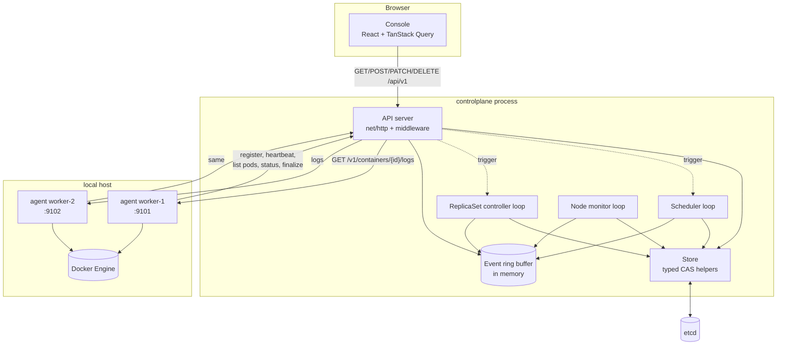
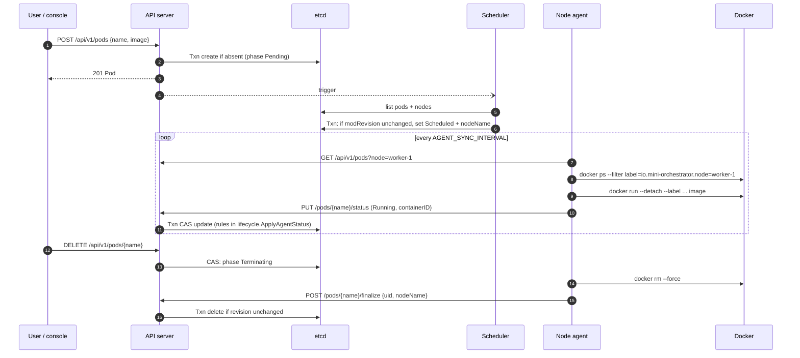
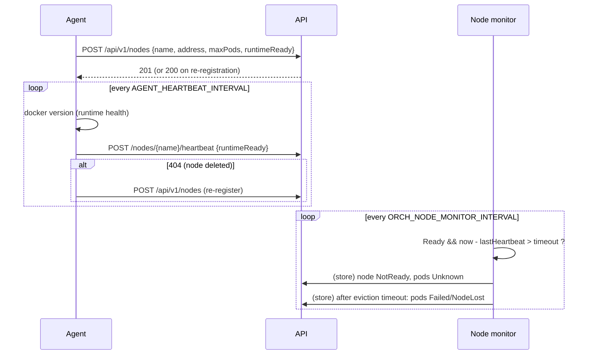

# Architecture

This document describes what the code in `backend/` and `frontend/` actually does. Where Mini Orchestrator borrows a Kubernetes idea, the difference is stated.

## Components and responsibilities

| Component | Package | Owns | Kubernetes analogue (and difference) |
|---|---|---|---|
| API server | `internal/api` | Validation, object creation, deletion requests, agent status intake, log proxying | kube-apiserver. Custom REST API, not Kubernetes-compatible. |
| Store | `internal/store` | etcd access, key schema, CAS updates | etcd usage. Project-specific schema; no watches. |
| Scheduler | `internal/scheduler` | `Pending → Scheduled` binding | kube-scheduler. One policy (`LeastPods`), pod-slot capacity only. |
| ReplicaSet controller | `internal/controller` | Creating/deleting owned pods, ReplicaSet status | ReplicaSet controller. Polls instead of watching. |
| Node monitor | `internal/controller` | Node `NotReady` on heartbeat expiry; pods `Unknown`/`NodeLost`; force-deleting stuck terminating pods | Node lifecycle controller. Simplified, no taints. |
| Node agent | `internal/agent` | Running containers, reporting pod status, finalizing deletions, serving logs | kubelet (conceptually). Polls the API; drives the Docker CLI; no CRI, probes or volumes. |
| Runtime | `internal/runtime` | Docker operations behind an interface | Container runtime. Direct Docker CLI, not CRI. |
| Console | `frontend/` | Read and operate the cluster through the API | Dashboard-like UI. Custom, not the Kubernetes Dashboard. |

The control plane (API, scheduler, controller, monitor) runs as **one process**. Each node agent is **its own process**. Agents never touch etcd; they only call the API. This keeps etcd credentials off worker hosts and gives the API one place to enforce transition rules.

## System diagram



## Desired versus observed state

Every object stores `spec` (desired, written by users) and `status` (observed, written by system components):

- **Pod**: `spec.image`, `spec.restartPolicy` vs `status.phase`, `nodeName`, `containerID`, `restartCount`, `exitCode`, `reason`, `message`, timestamps.
- **ReplicaSet**: `spec.replicas`, `spec.template.image` vs `status.replicas` (active owned pods), `status.runningReplicas`.
- **Node**: `spec.unschedulable` (cordon) vs `status.ready`, `reason`, `lastHeartbeatTime`, `runtimeReady`, `maxPods`, `address`.

Node assignment (`status.nodeName`) lives in status because only the scheduler writes it; users cannot set it (unknown request fields are rejected).

## Pod phases and transition ownership

| From | To | Written by | Condition |
|---|---|---|---|
| (none) | Pending | API server | `POST /api/v1/pods` or ReplicaSet controller creates a pod |
| Pending | Scheduled | Scheduler | An eligible node exists; CAS on the pod's revision |
| Scheduled / Running / Unknown | Running | Node agent | Container started, restarted, or seen running again |
| Scheduled / Running / Unknown | Succeeded | Node agent | `restartPolicy: Never` and exit code 0 |
| Scheduled / Running / Unknown | Failed | Node agent | Image pull or start failure; exit ≠ 0 with `Never`; restart limit reached; container vanished with `Never` |
| Scheduled / Running | Unknown | Node monitor | Assigned node is NotReady |
| Scheduled / Running / Unknown | Failed (`NodeLost`) | Node monitor | Node NotReady longer than `ORCH_POD_EVICTION_TIMEOUT`, or node record gone |
| any | Terminating | API server | `DELETE` while a node holds the pod |
| any unassigned | (deleted) | API server | `DELETE` of a pod with no node, or whose node no longer exists |
| Terminating | (deleted) | Node agent via `/finalize`, or node monitor (force) | Container removed; or node lost |

The rules live in `internal/lifecycle` and are enforced server-side: an agent that reports on a pod it does not own, a re-created pod (UID mismatch), a terminating pod, or a terminal pod receives `409 CONFLICT`.

While a container with `restartPolicy: Always` is backing off between restarts, the phase stays `Running` and `status.reason` is `RestartBackOff` (as Kubernetes keeps `Running` during CrashLoopBackOff). The console flags these pods under "Needs attention".

### Lifecycle sequence



## etcd key layout and persistence semantics

```text
/mini-orchestrator/v1/pods/{name}          JSON domain.Pod
/mini-orchestrator/v1/nodes/{name}         JSON domain.Node
/mini-orchestrator/v1/replicasets/{name}   JSON domain.ReplicaSet
```

- The prefix is configurable (`ORCH_ETCD_PREFIX`) so tests or demos can share one etcd. There are no namespaces; names are global per kind.
- **Create** is a transaction `If(CreateRevision(key) == 0) Then(Put)`: duplicates return `ALREADY_EXISTS`.
- **Update** is read → mutate → `If(ModRevision(key) == seen) Then(Put) Else(Get)`. On conflict it re-reads and retries up to 5 times; the `Else` branch distinguishes "deleted meanwhile" (`NOT_FOUND`) from "changed meanwhile" (`CONFLICT`). A mutate function can return `ErrNoChange` to skip the write, which keeps repeated reconciliation passes write-free.
- **Delete** is conditional on the revision the caller checked (for example, the pod UID).
- The etcd client caps gRPC's reconnect backoff at 5 s (the library default can wait up to 2 minutes after an outage) and has its own logger muted; the store logs failures with request context instead.
- Every etcd call has a deadline (`ORCH_ETCD_OP_TIMEOUT`). Client errors become `ErrUnavailable`, which the API maps to `503 STORE_UNAVAILABLE` without exposing endpoints or error text.
- Malformed JSON under a key is reported as `ErrCorrupt` on reads and skipped (with a warning log) in lists, so one bad record cannot break list endpoints or loops.
- Events are **not** stored in etcd (see DECISIONS.md, ADR-005).

## Scheduler

`scheduler.Place` is a pure function, tested without I/O:

1. Sort nodes by name.
2. Exclude cordoned nodes, NotReady nodes, and nodes whose last heartbeat is older than the heartbeat timeout (even if the monitor has not marked them yet).
3. Exclude nodes whose occupied slots (pods in Scheduled/Running/Unknown/Terminating) reach `maxPods`.
4. Pick the node with the fewest occupied slots; ties go to the lexicographically first name.

If nothing is eligible, the pod stays Pending with reason `InsufficientCapacity` (some eligible nodes exist but all are full) or `NoEligibleNodes`, and a message such as `0/3 nodes available: 1 not ready, 0 heartbeat stale, 1 cordoned, 1 at pod capacity`. The reason is written only when it changes, so a stuck pod does not cause a write every pass.

`RunOnce` handles pending pods oldest-first and updates its in-memory slot counts after each binding, so one pass spreads a burst of pods. Binding is a CAS that only succeeds if the pod is still Pending, not deleting, and has the same UID.

**Trade-offs.** Least-pods spreading is simple, deterministic and explainable, but treats all pods as equal. Real resource-aware scheduling needs declared requests and node allocatable capacity; it is on the roadmap rather than approximated with live CPU readings (the original prototype's `top`-based CPU filter could not be trusted as capacity).

## ReplicaSet controller

Each pass (every `ORCH_CONTROLLER_INTERVAL`, or immediately after a ReplicaSet API write):

1. List ReplicaSets and pods once.
2. Pods whose owner (name **and** UID) no longer exists and that are not already terminating are deleted (cascade). Bare pods are never touched.
3. For each ReplicaSet: terminal owned pods are deleted (they will be replaced); active pods are counted.
4. Too few → create up to 10 pods this pass, named `{rs}-{5 random chars}`. Too many → delete the surplus, choosing unscheduled first, then Unknown, then Scheduled, then Running; newest first within each group.
5. Status is updated only when counts change.

The pass is idempotent: it recomputes from stored state each time, so repeated passes converge and do not duplicate pods. Errors for one ReplicaSet are collected and do not stop the others; the loop backs off while errors persist.

## Node registration and heartbeats



- A node is Ready only while it heartbeats **and** its agent can reach Docker (`reason: RuntimeUnavailable` otherwise).
- Registration retries with exponential back-off (1 s to 30 s). The heartbeat loop runs at a fixed interval without back-off growth, because a late heartbeat would make the node stale.
- Deleting a node is refused while pods occupy it. A running agent re-registers on its next heartbeat.

## Node agent sync loop

Each pass lists the pods assigned to this node and the containers labelled for it, then reconciles pod by pod:

- Terminating → `docker rm --force`, then `POST /finalize`.
- Terminal → keep exited containers (for logs); remove any still running (for example after `NodeLost`).
- Scheduled/Running/Unknown → start if missing; report Running if running; on exit apply the restart policy with exponential back-off (`AGENT_RESTART_BACKOFF_*`) up to `AGENT_MAX_RESTARTS`.
- Containers whose pod UID is no longer assigned are removed as orphans. **Orphan cleanup runs only if both the pod list and the container list were read successfully**, so an API outage cannot delete running work.
- Status is reported only when it would change. A `409` means the pod changed on the server; the next pass acts on the new state.
- If Docker is unavailable, pods are not failed; the error is returned so the loop backs off, and heartbeats report `RuntimeUnavailable`.

## Docker runtime boundary

`runtime.Runtime` has `Ping`, `Run`, `Start`, `Inspect`, `List`, `Remove` (idempotent) and `Logs`. `runtime.Docker` implements it with the Docker CLI:

- Arguments are an argv slice passed to `exec.CommandContext`; no shell is involved. Images are validated to start with an alphanumeric character so they cannot be parsed as flags.
- Containers are created with `--restart no`, labels identifying node, pod name and pod UID, no `--privileged`, no mounts and no published ports.
- Every command has a deadline; output is size-bounded. Errors are classified as `ErrNotFound`, `ErrUnavailable` (daemon down, CLI missing, timeout) or `ErrImagePull`, which drive different pod reasons.
- Container names are `mo-{pod}-{first 8 chars of UID}`, so a re-created pod never collides with a predecessor's container.
- Logs are `docker logs --tail N`, combined stdout/stderr, keeping the most recent `AGENT_LOG_MAX_BYTES`.

`runtime.Fake` implements the same interface in memory and is used by all agent unit tests.

## Concurrency and shutdown

- Each background loop is exactly one goroutine run by `loop.Run`, so passes never overlap. A buffered (size 1) trigger channel lets API writes request an early pass; bursts coalesce.
- Consecutive failures back off exponentially up to `ORCH_LOOP_MAX_BACKOFF`.
- Shared in-memory state is limited to the event ring buffer (mutex-protected, no I/O under the lock) and the agent's restart-back-off map (only the sync goroutine touches it, guarded by a mutex anyway).
- `SIGINT`/`SIGTERM` cancel a root context. The control plane stops accepting HTTP requests (`Shutdown` with a 10 s deadline), waits for all loops to return, then closes the etcd client. The agent stops its loops and log server; **containers keep running** and are re-adopted by label on the next start.
- HTTP servers set read-header, read, write and idle timeouts; request bodies are capped.

## Console data flow

- One typed client (`src/lib/api/client.ts`) converts every non-2xx response into an `ApiError` with the server's code, message, field and request ID; network failures and timeouts are distinguished.
- Each resource has one TanStack Query key, so all widgets on a page share one request per 5-second interval. Polling pauses while the tab is hidden.
- Counts on the Overview are computed from API responses; when a request has failed, the value shows "Not available" rather than zero.
- The readiness indicator reflects `/readyz` (API process and etcd). It does not claim the cluster is healthy.
- Logs are fetched on demand; "Refresh every 5s" re-polls a snapshot and is labelled as such. Log text is rendered as text, never HTML.

## Alternatives considered

See [DECISIONS.md](DECISIONS.md) for etcd, separate scheduling and reconciliation, polling vs watches, the runtime interface, the simple scheduler, in-memory events, and agent-to-API communication.

## Current limitations

- One control-plane instance; no leader election. Two instances would bind safely but could exceed `maxPods` and double-create ReplicaSet pods.
- Polling with full lists every few seconds; adequate for tens of objects.
- No authentication, TLS, quotas or namespaces; node registration is trusted.
- All local agents share one Docker daemon.
- Logs are snapshots; events are lost on restart.
